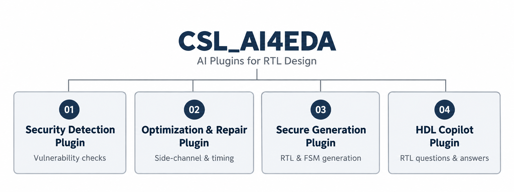
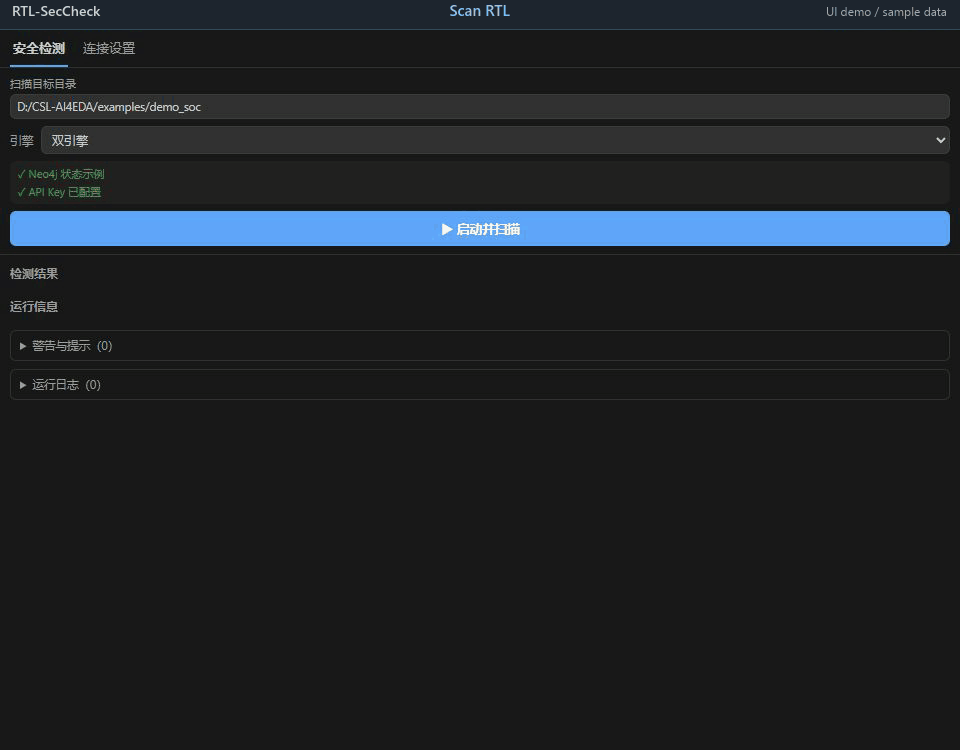
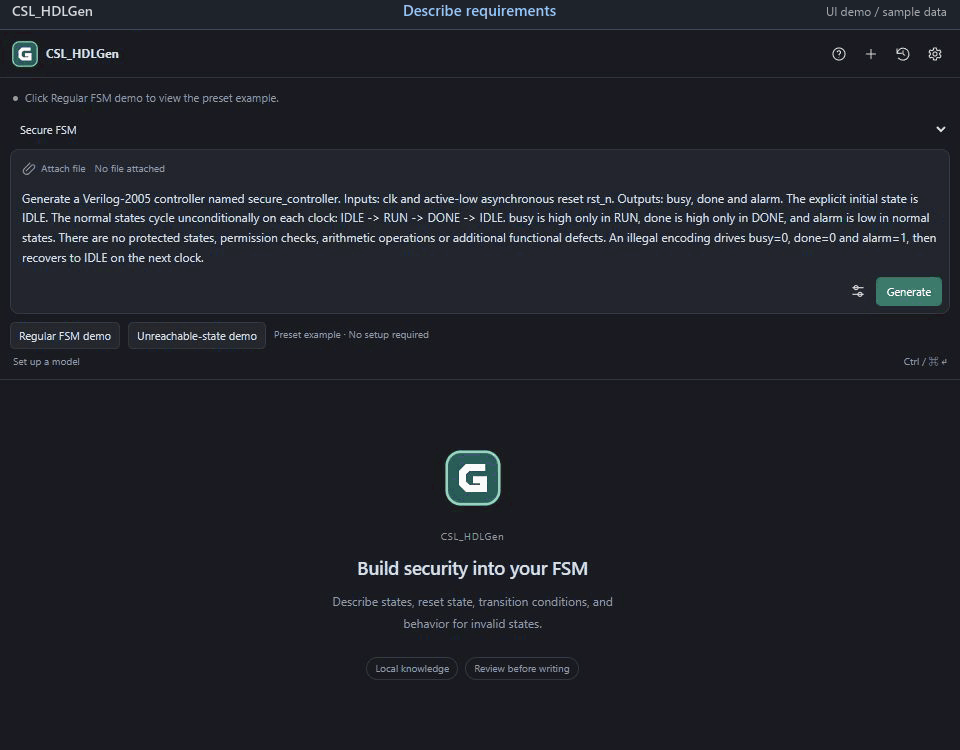

# CSL_AI4EDA

<div align="center">

**AI Plugins for Chip Design**

[](docs/DOWNLOADS.md)

[English](README.md) · [简体中文](README.zh-CN.md)

[Plugins](#plugins) · [Downloads](docs/DOWNLOADS.md) · [User guide](docs/USER_GUIDE.md) · [Framework](docs/ARCHITECTURE.md)



</div>

CSL_AI4EDA brings together AI plugins for RTL vulnerability checks, optimization and repair, Verilog generation, and HDL questions. Each plugin has its own installation requirements and release version.

**Preview distributions:** packages are offered for trial use. See each plugin's release notes for the checks performed and remaining validation, including fresh-machine setup.

This repository contains introductions, installation and user guides, and example designs. Installable distributions are organized as separate GitHub Releases; development engineering trees are maintained separately. Installation packages may contain readable runtime scripts and third-party components.

## Plugins

| Plugin | VS Code package version | Main purpose | Interfaces |
| --- | --- | --- | --- |
| [**Security Detection Plugin**](plugins/01-security-detection/README.md) | 0.1.1 (revision 2) | RTL vulnerabilities and module access permissions | VS Code; shared runtime; Vivado Tcl entry |
| [**Optimization & Repair Plugin**](plugins/02-optimization-repair/README.md) | 0.5.5 | Side-channel mitigation and timing optimization | Windows VS Code; Vivado integration for timing |
| [**Secure Generation Plugin**](plugins/03-secure-generation/README.md) | 0.3.16 | Knowledge-assisted Verilog and FSM generation | VS Code; Vivado companion interface |
| [**HDL Copilot Plugin**](plugins/04-hdl-copilot/README.md) | 0.4.0 | HDL questions, explanations, and change suggestions | VS Code; Vivado companion interface |

Open a plugin page for its download files, environment requirements, examples, and validation scope. The detection distribution uses a VSIX with a matching external runtime; the optimization distribution includes its backend in the VSIX. A Vivado bridge or companion interface is described separately from an installable VS Code extension.

The previews below use the original plugin interfaces with demo or sample data. Zoom and highlights guide attention; validation status is shown in the interface.

### 1. Security Detection Plugin

Scan RTL, review reported findings, and locate affected modules in the dependency graph. [Plugin guide](plugins/01-security-detection/README.md)

<p align="center">

</p>

### 2. Optimization & Repair Plugin

Choose a repair workflow, review candidate status, and open the Diff entry for code comparison. [Plugin guide](plugins/02-optimization-repair/README.md)

<p align="center">

</p>

### 3. Secure Generation Plugin

Describe the design requirements and inspect generated Verilog, including FSM transitions and default-state recovery in the built-in demo. [Plugin guide](plugins/03-secure-generation/README.md)

<p align="center">

</p>

### 4. HDL Copilot Plugin

Ask about RTL behavior, read the explanation, and review a suggested code change. [Plugin guide](plugins/04-hdl-copilot/README.md)

<p align="center">

</p>

## Getting started

1. Choose a plugin and read its environment requirements.
2. Download the files listed in the [download guide](docs/DOWNLOADS.md) for that plugin and version.
3. Follow its installation guide and configure your own model service where required.
4. Start with the included examples and inspect the returned code and evidence before using a result in a design.

## Repository structure

```text
CSL-AI4EDA/
├── README.md
├── README.zh-CN.md
├── DISTRIBUTION_NOTICES.md
├── assets/                       Overview, plugin GIFs and lab identity
├── docs/                         Downloads, selection guide, framework
└── plugins/
    ├── 01-security-detection/
    ├── 02-optimization-repair/
    ├── 03-secure-generation/
    └── 04-hdl-copilot/
```

Each plugin directory contains English and Chinese introductions, usage guides, version notes, distribution notices, and the examples provided for that plugin. Installation packages are attached to Releases rather than committed to this tree.

## Documentation

- [Documentation index](docs/README.md)
- [Downloads and installation formats](docs/DOWNLOADS.md)
- [User guide](docs/USER_GUIDE.md) / [中文使用说明](docs/USER_GUIDE.zh-CN.md)
- [Framework and plugin interfaces](docs/ARCHITECTURE.md)
- [Distribution and attribution notices](DISTRIBUTION_NOTICES.md)

## Contact

<div align="center">

<p>

&nbsp;&nbsp;

</p>

<p><strong>WeChat Official Account:</strong> 芯片与安全实验室</p>
<p>Search for 芯片与安全实验室 in WeChat to follow our lab.</p>
<p>
<a href="mailto:zitenghu@hdu.edu.cn">zitenghu@hdu.edu.cn</a>
</p>

</div>
