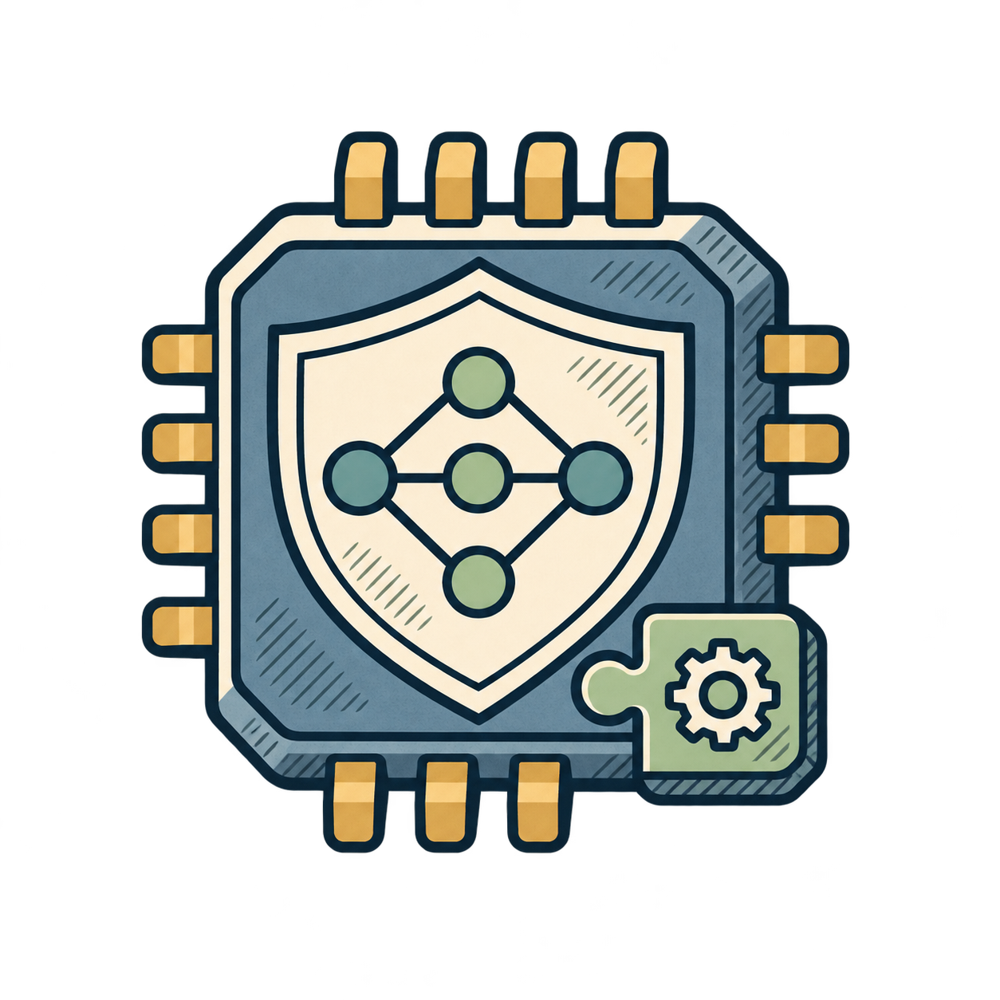
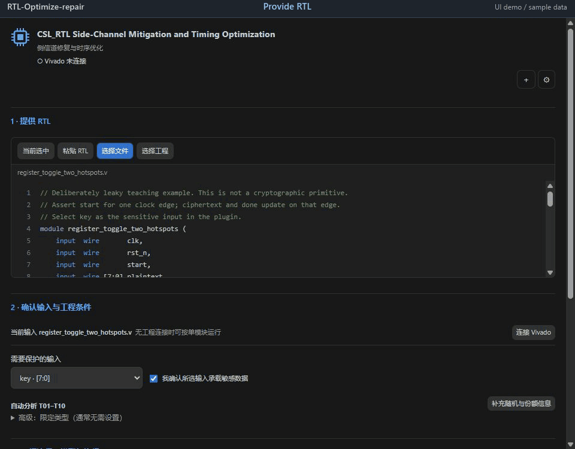
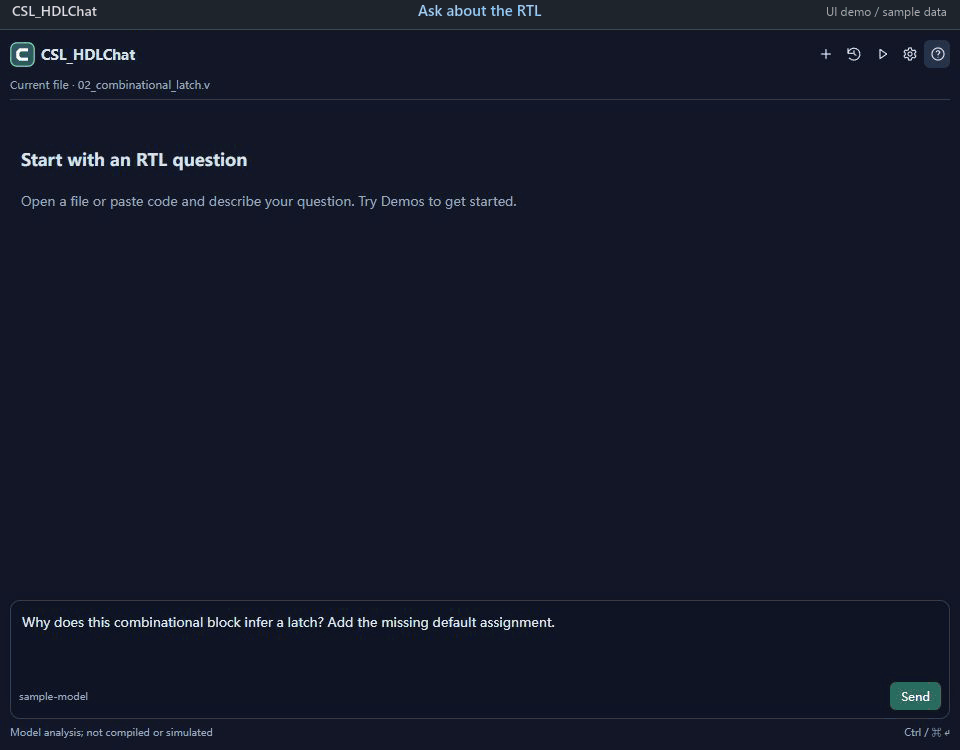

<h1>CSL_AI4EDA</h1>

<strong>AI Plugins for Chip Design</strong>

RTL security, optimization, Verilog generation and HDL Q&A — inside VS Code.

[English](README.md) · [简体中文](README.zh-CN.md)

> **Preview releases:** environment requirements and validation scope vary by plugin. See the linked installation guide and release notes.

## 🧩 Plugins

Choose a plugin for your task. Each has its own version and installation requirements.

| Plugin | What you can do | Download | Guide |
| --- | --- | --- | --- |
| [**Security Detection**](#1-security-detection-plugin) | Review RTL vulnerabilities and module access permissions | [Release](https://github.com/Chip-Security-Lab/CSL-AI4EDA/releases/tag/security-detection-v0.1.1-r2) | [Install & use](plugins/01-security-detection/USER_GUIDE.md) |
| [**Optimization & Repair**](#2-optimization--repair-plugin) | Mitigate side-channel leakage and address timing issues | [Release](https://github.com/Chip-Security-Lab/CSL-AI4EDA/releases/tag/optimization-repair-v0.5.5) | [Install & use](plugins/02-optimization-repair/USER_GUIDE.md) |
| [**Secure Generation**](#3-secure-generation-plugin) | Generate Verilog and FSMs with knowledge support | [Release](https://github.com/Chip-Security-Lab/CSL-AI4EDA/releases/tag/secure-generation-v0.3.16) | [Install & use](plugins/03-secure-generation/USER_GUIDE.md) |
| [**HDL Copilot**](#4-hdl-copilot-plugin) | Ask HDL questions and review code explanations and suggestions | [Release](https://github.com/Chip-Security-Lab/CSL-AI4EDA/releases/tag/hdl-copilot-v0.4.0) | [Install & use](plugins/04-hdl-copilot/USER_GUIDE.md) |

**Security Detection needs both its VSIX and matching runtime ZIP.** The Optimization & Repair VSIX includes its backend. Exact files, versions and companion interfaces are listed in the [download guide](docs/DOWNLOADS.md).

## 🚀 Getting started

1. **Download:** choose a plugin above and get the required attachments from its Release.
2. **Install:** in desktop VS Code, open Extensions → `…` → **Install from VSIX…**. Follow the plugin guide for its runtime and system dependencies.
3. **Configure and try:** configure your model service where required, open an [included example](plugins/README.md), and review the output and validation status.

[Installation and configuration guide](docs/USER_GUIDE.md) · [Download details](docs/DOWNLOADS.md)

## 🎬 Plugin demos

[Security Detection](#1-security-detection-plugin) · [Optimization & Repair](#2-optimization--repair-plugin) · [Secure Generation](#3-secure-generation-plugin) · [HDL Copilot](#4-hdl-copilot-plugin)

Original plugin interfaces with demo or sample data. Verification results, where available, are shown in the interface.

###  01 Security Detection Plugin

Scan RTL, review reported findings, and locate affected modules in the dependency graph.

**In this demo:** select RTL → review a finding → locate the affected module.

[**Download**](https://github.com/Chip-Security-Lab/CSL-AI4EDA/releases/tag/security-detection-v0.1.1-r2) · [User guide](plugins/01-security-detection/USER_GUIDE.md) · [Examples](plugins/01-security-detection/examples/README.md)

###  02 Optimization & Repair Plugin

Choose a repair workflow and inspect its candidate code and evidence.

**In this demo:** choose a sensitive input → review the unverified candidate status → locate the Diff entry.

[**Download**](https://github.com/Chip-Security-Lab/CSL-AI4EDA/releases/tag/optimization-repair-v0.5.5) · [User guide](plugins/02-optimization-repair/USER_GUIDE.md) · [Examples](plugins/02-optimization-repair/examples/README.md)

###  03 Secure Generation Plugin

Describe design requirements and inspect generated Verilog and FSM logic.

**In this demo:** run the built-in FSM example → inspect state transitions → review default-state recovery.

[**Download**](https://github.com/Chip-Security-Lab/CSL-AI4EDA/releases/tag/secure-generation-v0.3.16) · [User guide](plugins/03-secure-generation/USER_GUIDE.md) · [Examples](plugins/03-secure-generation/examples/README.md)

###  04 HDL Copilot Plugin

Ask about RTL behavior, read the explanation, and review a suggested code change.

**In this demo:** ask about an incomplete assignment → read the explanation → review the proposed default assignment.

[**Download**](https://github.com/Chip-Security-Lab/CSL-AI4EDA/releases/tag/hdl-copilot-v0.4.0) · [User guide](plugins/04-hdl-copilot/USER_GUIDE.md) · [Examples](plugins/04-hdl-copilot/examples/README.md)

## 📰 Latest updates

- **2026-11-22** — Added four interface demo GIFs with zoom and highlights; refreshed homepage navigation and quick start.
- **2026-11-04** — Updated the four preview distributions, download entries, examples and user guides.

[Update history](docs/CHANGELOG.md)

## 📚 Documentation

| Start here | Details |
| --- | --- |
| [Downloads](docs/DOWNLOADS.md) | Per-plugin packages, versions and required attachments |
| [User guide](docs/USER_GUIDE.md) / [中文使用说明](docs/USER_GUIDE.zh-CN.md) | Installation, environment setup and plugin selection |
| [Plugin introductions and examples](plugins/README.md) | Plugin pages and provided example designs |
| [Framework](docs/ARCHITECTURE.md) | Interfaces, repository structure and distribution details |
| [Distribution notices](DISTRIBUTION_NOTICES.md) | Component attribution and distribution information |

[All documentation](docs/README.md)

## ✉️ Contact

<strong>Chip Security Lab · Hangzhou Dianzi University</strong>

&nbsp;&nbsp;

<strong>WeChat Official Account:</strong> 芯片与安全实验室

Search for 芯片与安全实验室 in WeChat for lab news and plugin updates.

<a href="mailto:zitenghu@hdu.edu.cn">zitenghu@hdu.edu.cn</a>

