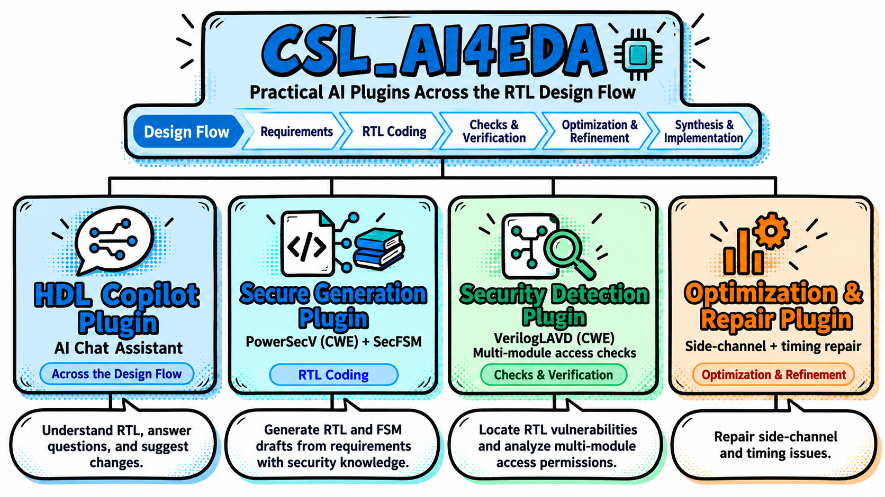

# CSL_AI4EDA

<div align="center">

**Practical AI Plugins Across the RTL Design Flow**

[English](README.md) · [简体中文](README.zh-CN.md)

[Plugin Overview](#plugins) · [User Guide](docs/USER_GUIDE.md) · [Framework](docs/ARCHITECTURE.md)



</div>

CSL_AI4EDA presents AI-assisted plugins for RTL design, covering design questions, knowledge-assisted generation, security analysis, and optimization and repair. The plugins are organized around familiar stages of the hardware design flow.

This first publication contains **documentation, the repository framework, and illustrations**. Source code, plugin engineering files, and installation packages are outside the scope of this documentation release.

## Plugins

| Plugin | Main purpose | Design stage |
| --- | --- | --- |
| [**HDL Copilot Plugin**](plugins/hdl-copilot/README.md) | Understand RTL, answer design questions, and review suggested changes. | Across the design flow |
| [**Secure Generation Plugin**](plugins/secure-generation/README.md) | Generate RTL and FSM drafts from requirements with security knowledge. | RTL coding |
| [**Security Detection Plugin**](plugins/security-detection/README.md) | Locate RTL vulnerabilities and analyze multi-module access permissions. | Checks and verification |
| [**Optimization & Repair Plugin**](plugins/optimization-repair/README.md) | Address side-channel and timing issues. | Optimization and refinement |

The design-flow strip in the overview provides context, including synthesis and implementation. Each plugin page describes its own scope and documentation.

## Getting started

1. **Choose a plugin** according to your design task using the table above.
2. **Read the [user guide](docs/USER_GUIDE.md)** for the interaction flow and model configuration concepts.
3. **Review the [framework](docs/ARCHITECTURE.md)** to understand how the plugin guides and future implementation entries are organized.

The guide introduces the existing VS Code and Vivado interaction patterns for HDL Copilot and Secure Generation. Installation downloads and executable entry points will be documented alongside implementation releases.

## Repository structure

```text
CSL-AI4EDA/
├── README.md
├── README.zh-CN.md
├── assets/
│   └── overview-plugins.en.png
├── docs/
│   ├── README.md
│   ├── ARCHITECTURE.md
│   ├── USER_GUIDE.md
│   └── USER_GUIDE.zh-CN.md
└── plugins/
    ├── README.md
    ├── hdl-copilot/README.md
    ├── secure-generation/README.md
    ├── security-detection/README.md
    └── optimization-repair/README.md
```

## Documentation

- [Documentation index](docs/README.md)
- [User guide](docs/USER_GUIDE.md) / [中文使用说明](docs/USER_GUIDE.zh-CN.md)
- [Framework and plugin interfaces](docs/ARCHITECTURE.md)
- [Plugin directory](plugins/README.md)

Questions and documentation feedback can be submitted through this repository's [Issues](https://github.com/Chip-Security-Lab/CSL-AI4EDA/issues).
