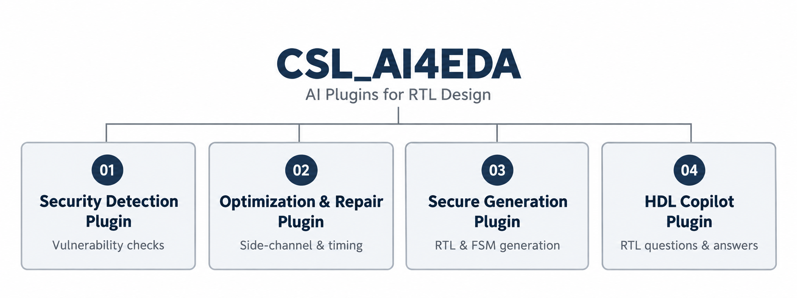
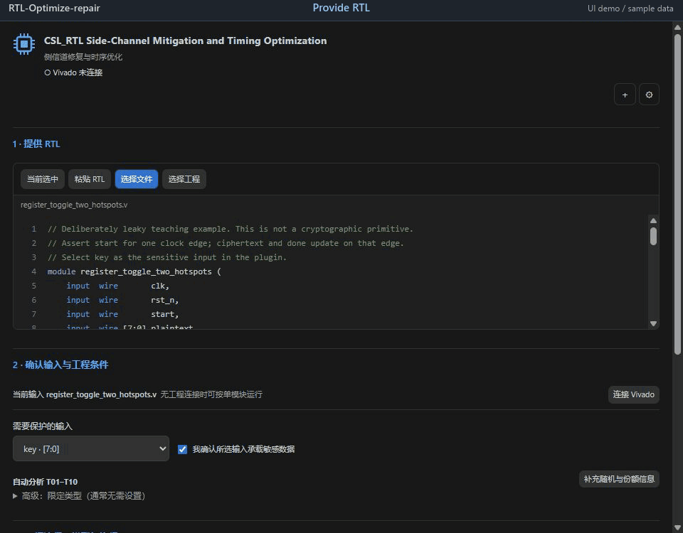
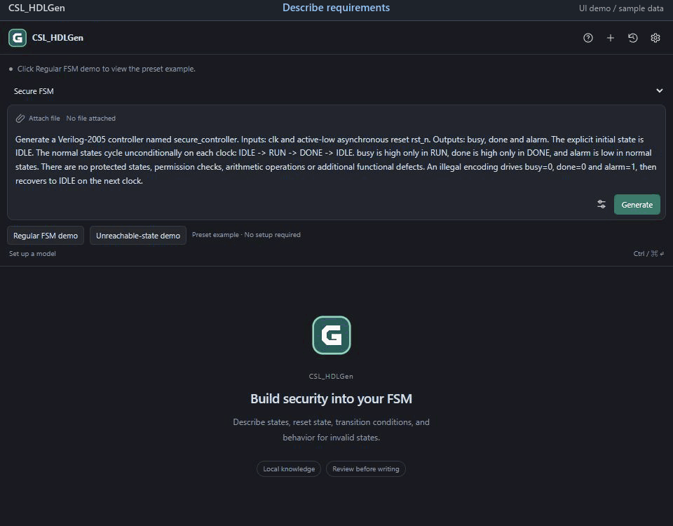
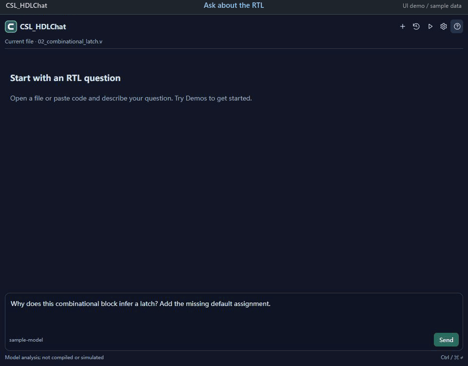

# CSL_AI4EDA

<div align="center">

**面向芯片设计的 AI 插件 · AI Plugins for Chip Design**

[](docs/DOWNLOADS.md)

[English](README.md) · [简体中文](README.zh-CN.md)

[插件概览](#插件概览) · [下载说明](docs/DOWNLOADS.md) · [使用说明](docs/USER_GUIDE.zh-CN.md) · [框架说明](docs/ARCHITECTURE.md)



</div>

CSL_AI4EDA 汇集 RTL 漏洞检查、优化与修复、Verilog 生成和 HDL 问答插件。各插件独立维护版本，环境要求以各自使用说明为准。

**当前提供试用分发版本。** 已完成的检查及尚待验证的项目（包括全新机器安装）见各插件的发布说明。

仓库提供插件介绍、安装与使用说明、示例设计；安装包通过各插件对应的 GitHub Releases 分发。开发工程另行维护，安装包内可能包含可读的运行脚本及第三方组件。

## 插件概览

| 插件 | VS Code 包版本 | 主要用途 | 交互入口 |
| --- | --- | --- | --- |
| [Security Detection Plugin](plugins/01-security-detection/README.zh-CN.md) | 0.1.1（修订版 2） | RTL 漏洞检查与多模块权限分析 | VS Code＋配套运行目录；Vivado Tcl 入口 |
| [Optimization & Repair Plugin](plugins/02-optimization-repair/README.zh-CN.md) | 0.5.5 | 侧信道缓解与时序优化 | Windows 本地 VS Code；时序流程连接 Vivado |
| [Secure Generation Plugin](plugins/03-secure-generation/README.zh-CN.md) | 0.3.16 | 知识辅助 Verilog / FSM 生成 | VS Code；Vivado 配套界面 |
| [HDL Copilot Plugin](plugins/04-hdl-copilot/README.zh-CN.md) | 0.4.0 | HDL 问答、代码解释与修改建议 | VS Code；Vivado 配套界面 |

具体下载文件、依赖、示例入口和验证范围见各插件页面。检测插件需要 VSIX 与配套后端运行包；优化插件的 VSIX 已包含后端。Vivado 桥接和配套界面的安装方式分别说明。

以下动图保留插件原始界面，使用内置 Demo 或示例数据。放大和框选用于引导阅读，验证状态以界面显示为准。

### 1. 漏洞检测插件

扫描 RTL、查看问题报告，并通过模块依赖图定位相关模块。[插件说明](plugins/01-security-detection/README.zh-CN.md)

<p align="center">

</p>

### 2. 优化与修复插件

选择修复流程、查看候选状态，并找到用于比较代码的 Diff 入口。[插件说明](plugins/02-optimization-repair/README.zh-CN.md)

<p align="center">

</p>

### 3. Verilog 生成插件

输入设计需求并查看生成的 Verilog；内置 FSM 示例展示状态跳转与默认状态恢复。[插件说明](plugins/03-secure-generation/README.zh-CN.md)

<p align="center">

</p>

### 4. HDL 问答插件

围绕 RTL 行为提问，阅读代码解释并审阅修改建议。[插件说明](plugins/04-hdl-copilot/README.zh-CN.md)

<p align="center">

</p>

## 开始使用

1. 按任务选择插件，先确认其系统和工具要求。
2. 根据[下载说明](docs/DOWNLOADS.md)获取该插件对应版本的文件。
3. 按插件手册安装，并在需要时配置自己的模型服务。
4. 先运行随附示例，审阅候选代码和实际验证结果后再用于设计。

## 仓库结构

```text
CSL-AI4EDA/
├── README.md
├── README.zh-CN.md
├── DISTRIBUTION_NOTICES.md
├── assets/                       总览图、插件动图与实验室标识
├── docs/                         下载导航、使用导航、框架说明
└── plugins/
    ├── 01-security-detection/
    ├── 02-optimization-repair/
    ├── 03-secure-generation/
    └── 04-hdl-copilot/
```

各插件目录保留中英文介绍、使用说明、版本记录、分发说明和已有示例。安装包作为 Release 附件，不放入上述仓库目录。

## 文档入口

- [文档索引](docs/README.md)
- [下载与安装格式](docs/DOWNLOADS.md)
- [中文使用说明](docs/USER_GUIDE.zh-CN.md) / [English user guide](docs/USER_GUIDE.md)
- [框架说明](docs/ARCHITECTURE.md)
- [分发与来源说明](DISTRIBUTION_NOTICES.md)

## 联系我们

<div align="center">

<p>

&nbsp;&nbsp;

</p>

<p><strong>微信公众号：</strong>芯片与安全实验室</p>
<p>在微信中搜索“芯片与安全实验室”，关注实验室动态。</p>
<p>
<a href="mailto:zitenghu@hdu.edu.cn">zitenghu@hdu.edu.cn</a>
</p>

</div>
