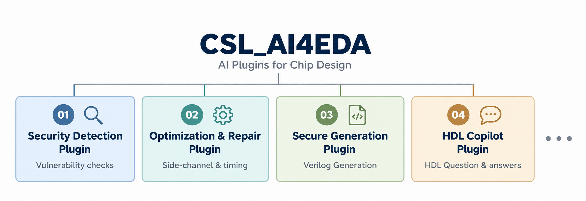
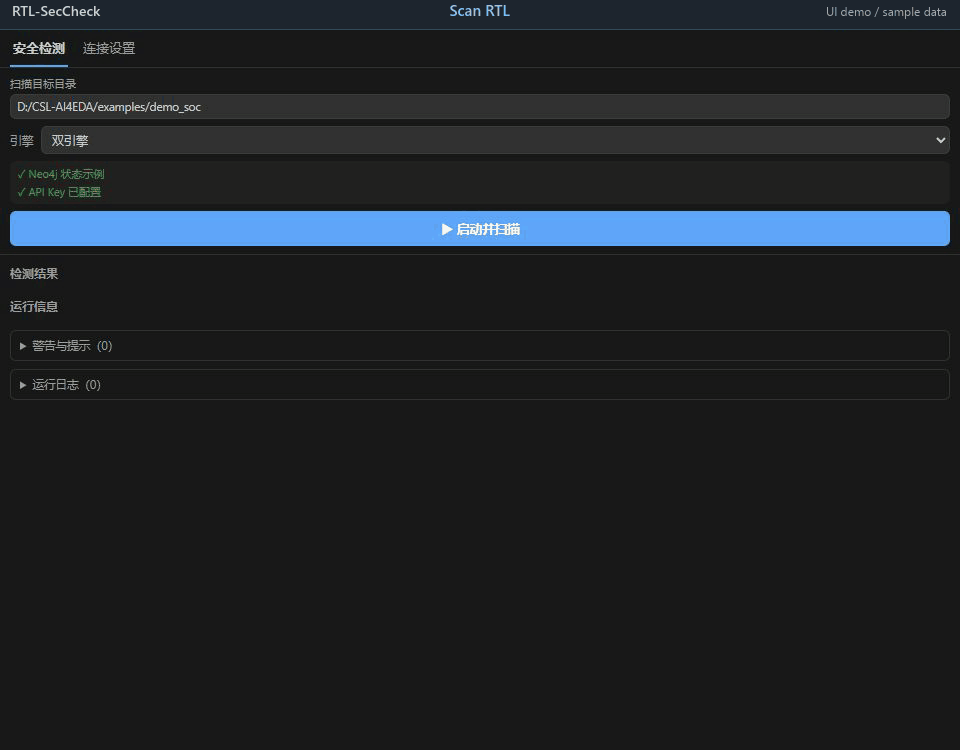

<h1>CSL_AI4EDA</h1>

<strong>AI Plugins for Chip Design · 面向芯片设计的 AI 插件</strong>

在 VS Code 中辅助完成 RTL 检测、优化、Verilog 生成与 HDL 问答。

[English](README.md) · [简体中文](README.zh-CN.md)

> **当前提供试用分发版本。** 各插件的环境要求和验证范围不同，安装前请查看对应手册和发布说明。

## 插件概览

按任务选择插件，各插件独立维护版本与安装要求。

| 插件 | 可以做什么 | 下载 | 使用文档 |
| --- | --- | --- | --- |
| [**漏洞检测**](#1-漏洞检测插件) | 检查 RTL 漏洞与多模块访问权限 | [发布页](https://github.com/Chip-Security-Lab/CSL-AI4EDA/releases/tag/security-detection-v0.1.1-r2) | [安装与使用](plugins/01-security-detection/USER_GUIDE.zh-CN.md) |
| [**优化与修复**](#2-优化与修复插件) | 缓解侧信道泄漏、处理时序问题 | [发布页](https://github.com/Chip-Security-Lab/CSL-AI4EDA/releases/tag/optimization-repair-v0.5.5) | [安装与使用](plugins/02-optimization-repair/USER_GUIDE.zh-CN.md) |
| [**Verilog 生成**](#3-verilog-生成插件) | 基于知识支持生成 Verilog 与 FSM | [发布页](https://github.com/Chip-Security-Lab/CSL-AI4EDA/releases/tag/secure-generation-v0.3.16) | [安装与使用](plugins/03-secure-generation/USER_GUIDE.zh-CN.md) |
| [**HDL 问答**](#4-hdl-问答插件) | HDL 问答、代码解释与修改建议 | [发布页](https://github.com/Chip-Security-Lab/CSL-AI4EDA/releases/tag/hdl-copilot-v0.4.0) | [安装与使用](plugins/04-hdl-copilot/USER_GUIDE.zh-CN.md) |

**检测插件需要同时下载 VSIX 和配套运行包 ZIP。** 优化与修复插件的 VSIX 已包含后端。具体版本、文件和配套界面见[下载说明](docs/DOWNLOADS.md)。

## 开始使用

1. **下载：** 按上表选择插件，在对应发布页获取所需附件。
2. **安装：** 在桌面版 VS Code 中选择“扩展 → `…` → Install from VSIX…”。按插件手册完成运行环境与依赖配置。
3. **配置并试用：** 在需要时配置自己的模型服务，打开[随附示例](plugins/README.md)，检查输出和实际验证状态。

[安装与配置指南](docs/USER_GUIDE.zh-CN.md) · [下载详情](docs/DOWNLOADS.md)

## 插件演示

[漏洞检测](#1-漏洞检测插件) · [优化与修复](#2-优化与修复插件) · [Verilog 生成](#3-verilog-生成插件) · [HDL 问答](#4-hdl-问答插件)

以下动图使用插件原始界面与内置 Demo 或示例数据；涉及验证时，以实际界面状态为准。

### 1. 漏洞检测插件

扫描 RTL、查看问题报告，并通过模块依赖图定位相关模块。

**演示看点：** 选择 RTL → 查看问题 → 定位相关模块。

[**下载插件**](https://github.com/Chip-Security-Lab/CSL-AI4EDA/releases/tag/security-detection-v0.1.1-r2) · [使用说明](plugins/01-security-detection/USER_GUIDE.zh-CN.md) · [示例文件](plugins/01-security-detection/examples/README.md)

### 2. 优化与修复插件

选择修复流程，审阅候选代码与相应证据。

**演示看点：** 选择敏感输入 → 查看候选的未验证状态 → 找到 Diff 入口。

[**下载插件**](https://github.com/Chip-Security-Lab/CSL-AI4EDA/releases/tag/optimization-repair-v0.5.5) · [使用说明](plugins/02-optimization-repair/USER_GUIDE.zh-CN.md) · [示例文件](plugins/02-optimization-repair/examples/README.md)

### 3. Verilog 生成插件

输入设计需求，查看生成的 Verilog 和 FSM 逻辑。

**演示看点：** 运行内置 FSM 示例 → 查看状态跳转 → 审阅默认恢复分支。

[**下载插件**](https://github.com/Chip-Security-Lab/CSL-AI4EDA/releases/tag/secure-generation-v0.3.16) · [使用说明](plugins/03-secure-generation/USER_GUIDE.zh-CN.md) · [示例文件](plugins/03-secure-generation/examples/README.md)

### 4. HDL 问答插件

围绕 RTL 行为提问，阅读代码解释并审阅修改建议。

**演示看点：** 针对不完整赋值提问 → 阅读解释 → 审阅默认赋值建议。

[**下载插件**](https://github.com/Chip-Security-Lab/CSL-AI4EDA/releases/tag/hdl-copilot-v0.4.0) · [使用说明](plugins/04-hdl-copilot/USER_GUIDE.zh-CN.md) · [示例文件](plugins/04-hdl-copilot/examples/README.md)

## 最近更新

- **2026-11-22** — 新增四个插件的界面 GIF，加入放大和重点框选；调整首页导航与快速开始。
- **2026-11-04** — 更新四个插件的试用分发文件、下载入口、示例与使用说明。

[查看更新记录](docs/CHANGELOG.zh-CN.md)

## 文档入口

| 从这里开始 | 内容 |
| --- | --- |
| [下载说明](docs/DOWNLOADS.md) | 各插件安装包、版本与必需附件 |
| [中文使用说明](docs/USER_GUIDE.zh-CN.md) / [English user guide](docs/USER_GUIDE.md) | 安装、环境配置与插件选择 |
| [插件介绍与示例](plugins/README.md) | 各插件介绍和已有示例设计 |
| [框架说明](docs/ARCHITECTURE.md) | 交互入口、仓库结构与分发方式 |
| [分发与来源说明](DISTRIBUTION_NOTICES.md) | 组件来源与分发信息 |

[全部文档](docs/README.md)

## 联系我们

<strong>杭州电子科技大学 · 芯片与安全实验室</strong>

&nbsp;&nbsp;

<strong>微信公众号：</strong>芯片与安全实验室

在微信中搜索“芯片与安全实验室”，了解实验室动态与插件更新。

<a href="mailto:zitenghu@hdu.edu.cn">zitenghu@hdu.edu.cn</a>

