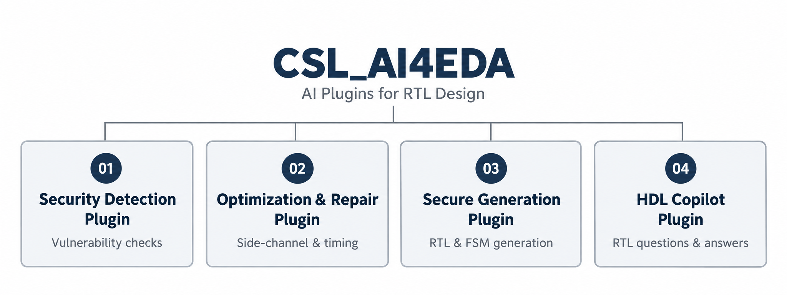

# CSL_AI4EDA

<div align="center">

**面向 RTL 设计的 AI 插件**

[English](README.md) · [简体中文](README.zh-CN.md)

[插件概览](#插件概览) · [使用说明](docs/USER_GUIDE.zh-CN.md) · [框架说明](docs/ARCHITECTURE.md)



</div>

CSL_AI4EDA 围绕 RTL 设计流程组织 AI 辅助能力，依次展示漏洞检查、优化与修复、知识辅助生成和设计问答。

本次先发布**目录框架、使用说明、首页介绍和总览图**。具体实现代码、插件工程文件及安装包将在后续实现发布时提供。

## 插件概览

| 插件 | 主要用途 | 对应设计阶段 |
| --- | --- | --- |
| [**Security Detection Plugin**](plugins/01-security-detection/README.md) | 定位 RTL 漏洞，分析多模块访问权限。 | 检查与验证 |
| [**Optimization & Repair Plugin**](plugins/02-optimization-repair/README.md) | 处理侧信道与时序问题。 | 优化与完善 |
| [**Secure Generation Plugin**](plugins/03-secure-generation/README.md) | 结合安全知识，按需求生成 RTL 与 FSM 草稿。 | RTL 编写 |
| [**HDL Copilot Plugin**](plugins/04-hdl-copilot/README.md) | 理解 RTL、解答设计问题、审查修改建议。 | 贯穿设计流程 |

各插件的用途、能力范围和文档由对应介绍页分别说明。

## 如何阅读和使用

1. **选择插件**：根据当前设计任务，从上表进入相应介绍页。
2. **阅读[使用说明](docs/USER_GUIDE.zh-CN.md)**：了解交互方式、模型配置和结果审阅流程。
3. **查看[框架说明](docs/ARCHITECTURE.md)**：了解各插件文档及后续实现入口的组织方式。

使用说明介绍 Secure Generation 和 HDL Copilot 已有的 VS Code / Vivado 交互方式；安装下载及可执行入口会随具体实现一同发布。

## 仓库结构

```text
CSL-AI4EDA/
├── README.md
├── README.zh-CN.md
├── assets/                       总览图与图片说明
├── docs/                         使用说明与框架文档
└── plugins/
    ├── README.md
    ├── 01-security-detection/README.md
    ├── 02-optimization-repair/README.md
    ├── 03-secure-generation/README.md
    └── 04-hdl-copilot/README.md
```

## 文档入口

- [文档索引](docs/README.md)
- [中文使用说明](docs/USER_GUIDE.zh-CN.md) / [English user guide](docs/USER_GUIDE.md)
- [框架与插件接口说明](docs/ARCHITECTURE.md)
- [插件目录](plugins/README.md)

问题和文档建议可通过仓库的 [Issues](https://github.com/Chip-Security-Lab/CSL-AI4EDA/issues) 反馈。

## 联系我们

<div align="center">


<p><strong>微信公众号：</strong>芯片与安全实验室</p>
<p>在微信中搜索“芯片与安全实验室”，关注实验室动态。</p>
<p><strong>联系邮箱：</strong><a href="mailto:zitenghu@hdu.edu.cn">zitenghu@hdu.edu.cn</a></p>

</div>
