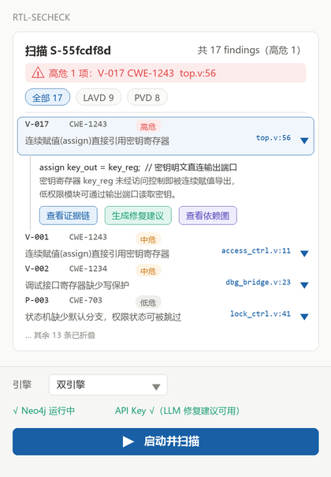

# Security Detection Plugin

[Home](../../README.md) · [简体中文](README.zh-CN.md) · [User guide](USER_GUIDE.md)

Inspect RTL structural vulnerability patterns and multi-module permission flows through a VS Code frontend, with a shared Python backend and an optional Vivado Tcl entry.

| Item | Distribution details |
| --- | --- |
| Installed name | CSL_RTL_SecCheck |
| VS Code frontend | 0.1.1-r2 (VS Code displays 0.1.1); VS Code 1.85+ |
| Backend snapshot | Supplied with this candidate; FastAPI metadata remains 0.1.0 |
| Documented environment | Windows, separate Python environments, Icarus; Neo4j for LAVD |
| Analysis engines | VerilogLAVD structural checks and VeriPVD permission analysis |
| Installation | VSIX **plus matching runtime ZIP** |

[Download entry: security-detection-v0.1.1-r2](https://github.com/Chip-Security-Lab/CSL-AI4EDA/releases/tag/security-detection-v0.1.1-r2) — preview distribution. Download both files; the VSIX alone has no backend.

1. Prepare the runtime and three dependency environments using the [user guide](USER_GUIDE.md).
2. Install the VSIX and set `cslRtlSeccheck.projectRoot` to the extracted runtime root.
3. Configure your engine interpreters, dedicated Neo4j instance, and model credentials.
4. Enter the absolute path to the included [demo_soc example](examples/README.md) in **Security Detection** (安全检测). The report and graph appear before the collapsed runtime logs.

**LAVD rebuilds graphs by clearing the connected Neo4j database. Use a dedicated empty database.** Its pyverilog parser also requires Icarus preprocessing.

The report above illustrates an earlier build. The r2 sidebar separates **Security Detection** and **Connection Settings**. If you already installed 0.1.1, [reinstall the revised VSIX](USER_GUIDE.md#interpret-results-and-update). Real engine, Neo4j, model, and VS Code integration checks remain to be performed. This preview distribution is not a claim of a clean-machine installation or measured detection accuracy. Review [third-party notices](THIRD_PARTY_NOTICES.md) before redistribution; upstream license documents are incomplete in the supplied archive.

- [Detailed guide](USER_GUIDE.md) / [中文使用说明](USER_GUIDE.zh-CN.md)
- [Examples](examples/README.md)
- [Version notes](CHANGELOG.md)
- [Third-party notices](THIRD_PARTY_NOTICES.md)
