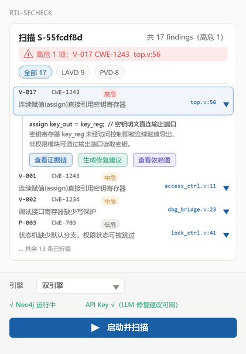

# Security Detection Plugin

[首页](../../README.zh-CN.md) · [English](README.md) · [使用说明](USER_GUIDE.zh-CN.md)

面向 RTL 结构漏洞和多模块权限流检查，提供 VS Code 前端、共用 Python 后端及可选 Vivado Tcl 入口。

| 项目 | 当前交付内容 |
| --- | --- |
| 安装显示名 | CSL_RTL_SecCheck |
| VS Code 前端 | 0.1.1，要求 VS Code 1.85+ |
| 后端快照 | 随本试用版提供，FastAPI 元数据仍为 0.1.0 |
| 文档适用环境 | Windows、独立 Python 环境、Icarus；LAVD 另需 Neo4j |
| 检测引擎 | VerilogLAVD 结构检查、VeriPVD 权限分析 |
| 安装形式 | **VSIX＋配套运行 ZIP** |

[下载入口：security-detection-v0.1.1](https://github.com/Chip-Security-Lab/CSL-AI4EDA/releases/tag/security-detection-v0.1.1)——试用分发版本。两个文件均需下载；单独 VSIX 不含后端。

1. 按[使用说明](USER_GUIDE.zh-CN.md)准备运行目录和三组依赖。
2. 安装 VSIX，将 `cslRtlSeccheck.projectRoot` 指向运行目录。
3. 配置引擎解释器、专用 Neo4j 数据库及自己的模型凭据。
4. 先扫描保留的 [demo_soc 示例](examples/README.md)，结合引擎警告查看报告、证据链及依赖图。

**LAVD 构图会清空所连接的 Neo4j 数据库，应使用专用空数据库。** LAVD 的 pyverilog 预处理也实际需要 Icarus。

示例和界面示意图来自提供的插件文件；图中报告不是此次整理的验证证据。当前整理未执行真实引擎、Neo4j、模型或 VS Code 联调，不代表全新机器安装及检测效果已验证。原包第三方许可证文件不完整，公开再分发前需补齐[第三方说明](THIRD_PARTY_NOTICES.md)中的事项。

- [中文使用说明](USER_GUIDE.zh-CN.md) / [English guide](USER_GUIDE.md)
- [示例](examples/README.md)
- [版本说明](CHANGELOG.md)
- [第三方说明](THIRD_PARTY_NOTICES.md)
