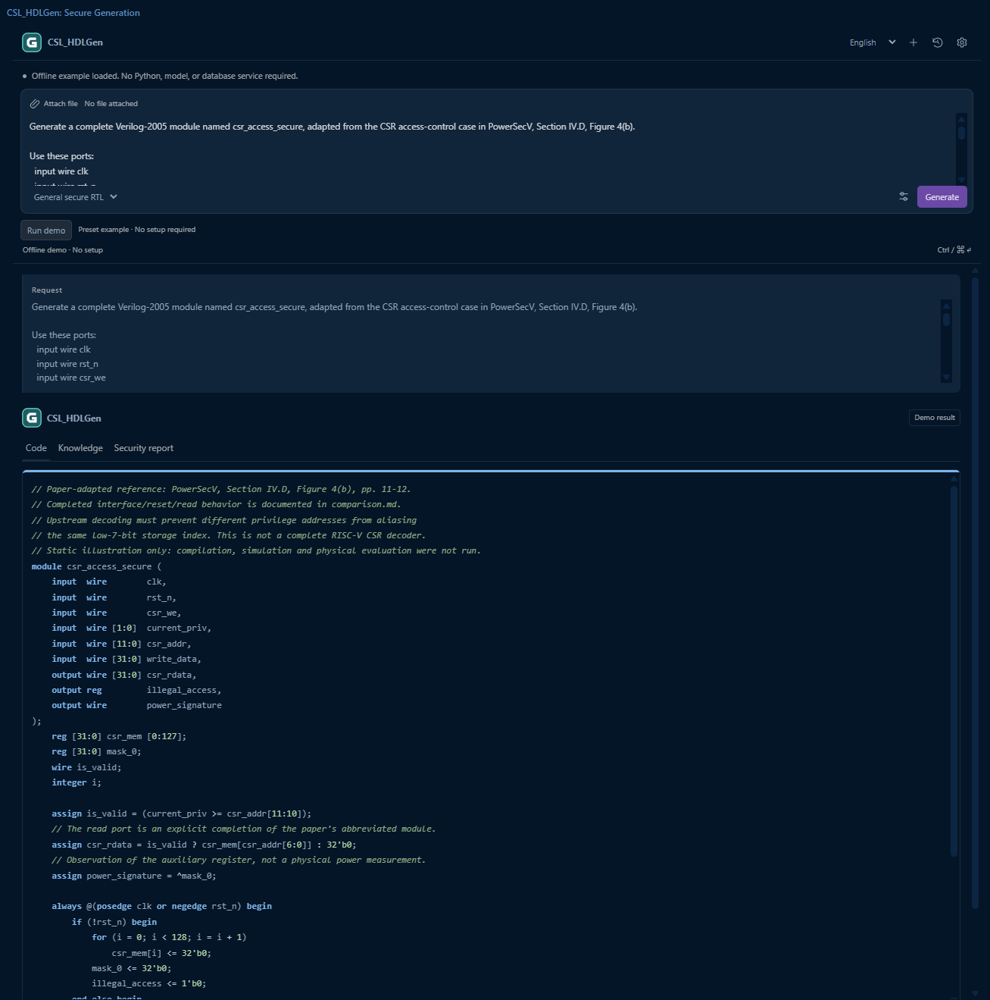

# Secure Generation Plugin

[首页](../../README.zh-CN.md) · [English](README.md) · [使用说明](USER_GUIDE.zh-CN.md) · [示例](examples/README.md)

根据需求生成安全导向的 **Verilog-2005**，提供通用 RTL、FSM 两条流程，以及代码、安全知识和安全报告；通用 RTL 可继续低功耗改写。安装名称保留 **CSL_HDLGen**，扩展标识 `csl-local.csl-hdlgen`。

*原工程提供的离线示例界面截图，不代表本次新增真实模型验证。*

| 交付文件 | 环境 / 内容 |
| --- | --- |
| `CSL_HDLGen-VSCode-0.3.15.vsix` | VS Code 1.85+、可信本地文件夹；自定义生成需 Python 3.10+ 和模型账号 |
| `CSL_HDLGen-for-Vivado.zip` | Vivado 配套界面，Python 3.10+；可选模式面板使用 Tkinter |
| `CSL_HDLGen-Examples.zip` | CSR 安全/低功耗参考、常规 FSM、FSM 功能修正案例 |
| `CSL_HDLGen-Demos.zip` | 三个自包含 HTML 离线预览，无需安装、模型或网络 |

**[试用版与下载](https://github.com/Chip-Security-Lab/CSL-AI4EDA/releases/tag/secure-generation-v0.3.15)**：当前为试用分发版本。标签沿用 VS Code 0.3.15，不表示 Vivado 另有同号版本。

首次打开提供四步引导，可跳过或点击 **?** 重看。选择通用安全生成或 FSM 安全生成，填写需求并查看代码、安全知识与安全报告；多版本 FSM 可通过选择器比较。功能修正版本可能改变行为，需确认符合设计意图。

两种接口都带后端和 SQLite 知识包，无需 Neo4j、Node.js 或额外 Python 包。VS Code 预置演示无需 Python 或模型；自定义生成需自己的兼容接口、模型和密钥。写入已有文件前需绑定文件、审阅差异、确认并备份。

## 案例

- [CSR 安全与低功耗参考](examples/README.md#general-csr-case)：按论文案例改编的静态对照，未进行编译、仿真、功耗或侧信道验证。
- [常规 FSM](examples/README.md#fsm-case)：保留需求、代码、testbench 和已有有限检查记录。
- [FSM 功能修正](examples/fsm-functional/README.md)：保留原版、修正版、报告、知识、差异和已有验证记录。
- [浏览器离线演示](examples/demos/README.md)：CSR、常规 FSM 和功能修正 FSM 三份 HTML。

25 个原始案例文件完整保留在仓库、VSIX、Vivado 配套包及独立案例 ZIP；离线 HTML 另提供 Demos ZIP。生成结果仍需验证，安全报告不是安全证明，低功耗参考不包含实测节能结论。

[使用说明](USER_GUIDE.zh-CN.md) · [Vivado 详细说明](VIVADO_GUIDE.zh-CN.md) · [版本记录](CHANGELOG.md) · [分发与来源](DISTRIBUTION_NOTES.md)
