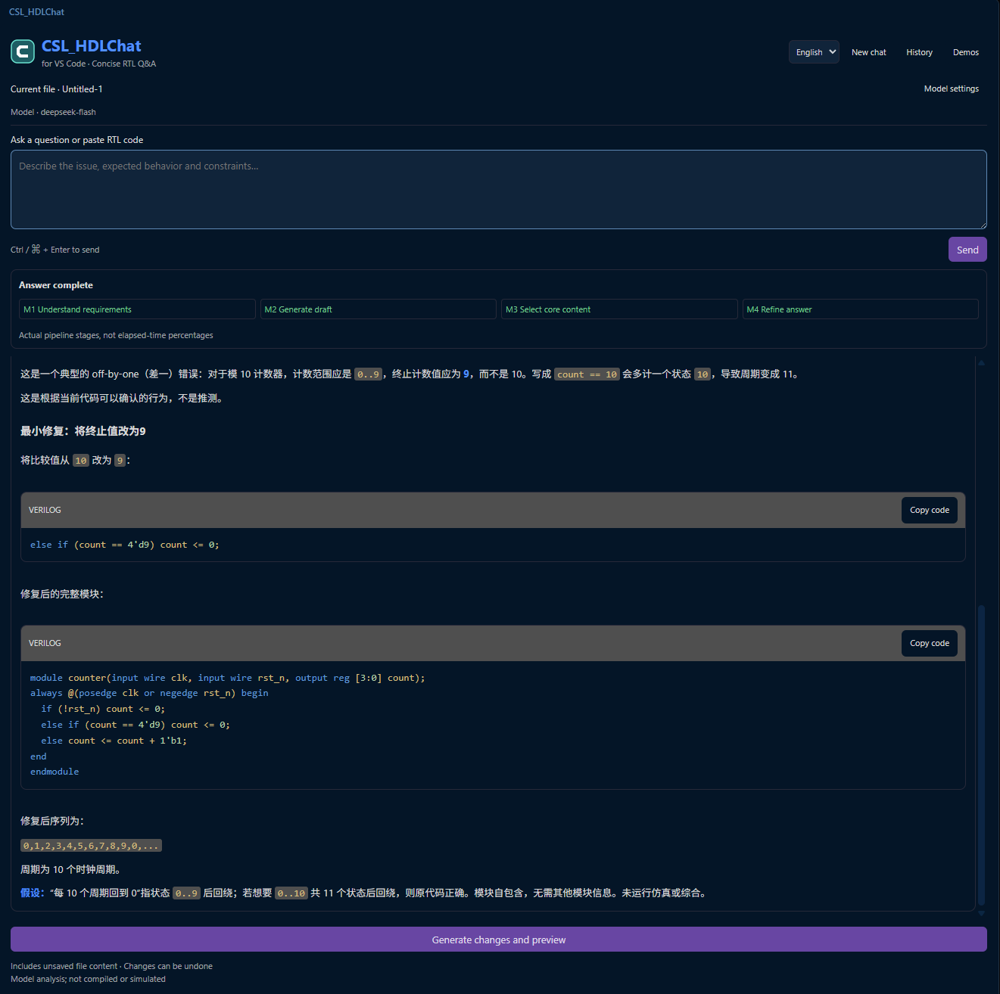

# HDL Copilot Plugin

[首页](../../README.zh-CN.md) · [English](README.md) · [使用说明](USER_GUIDE.zh-CN.md) · [示例](examples/README.md)

通过多轮 HDL 问答和可审阅修改，理解、排查和改进 Verilog/SystemVerilog。安装界面、文件名和扩展标识 `trustrtl-local.trustrtl` 继续使用 **CSL_HDLChat**，兼容已有配置。

原始界面截图保留英文控件和中文回答，界面语言与回答语言可以不同。

| 交付内容 | 版本与环境 | 文件 |
| --- | --- | --- |
| VS Code | **0.3.4**；桌面 VS Code 1.85+、Python 3.10+、可信工作区；文档记录的验证环境为本地 Windows | `CSL_HDLChat-0.3.4.vsix` |
| 示例 | 两个故意带缺陷的输入及中英提问说明已内置 VSIX，也保留独立下载 | `CSL_HDLChat-Examples.zip` |
| Vivado 配套界面 | Project Mode、Python 3.10+；可选模式面板需 Tkinter；未单独声明数字版本 | `CSL_HDLChat-for-Vivado.zip` |

[试用版与下载](https://github.com/Chip-Security-Lab/CSL-AI4EDA/releases/tag/hdl-copilot-v0.3.4)：当前为试用分发版本。Release 标签采用 VS Code 版本，不另行推断 Vivado 包版本。

## 本次更新

0.3.4 提供中英界面切换、可重看的四步新手引导、最新完整界面说明和截图，并将两个示例输入打入 VSIX。引导只介绍位置，不调用模型。模型配置在同一个表单填写，密钥使用 VS Code SecretStorage；保存本身不等于连通性测试。

使用“从 VSIX 安装”后，打开可信文件夹与 RTL，配置自己的模型再提问。[完整教程](USER_GUIDE.zh-CN.md)包含环境、模型配置、问答与历史、演示、差异预览和应用修改。

VS Code 每轮读取当前缓冲区，包括未保存内容；明确应用后自行保存。Vivado 读取已保存的工程文件，提供预览与复制，不从助手写回。本次已核对原 Vivado ZIP 全部文件仍与当前源一致，因此保持该包原样。

后端随包提供，普通使用只需 Python 标准库，不需 pip 或 Node.js。问题、RTL 与会话上下文会发送到自己的兼容 Chat Completions 服务。插件不自动编译、仿真、综合或测量 PPA。

[示例与提问说明](examples/README.md) · [版本变化](CHANGELOG.md) · [分发状态](DISTRIBUTION_NOTES.md)
